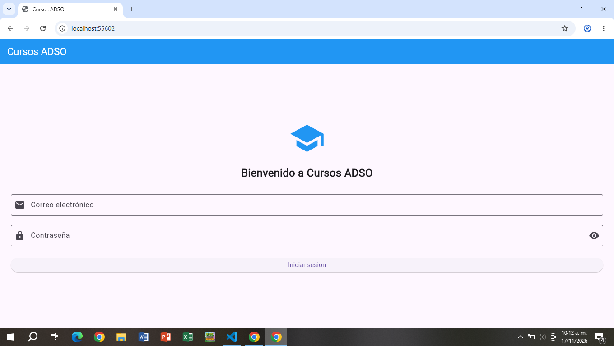
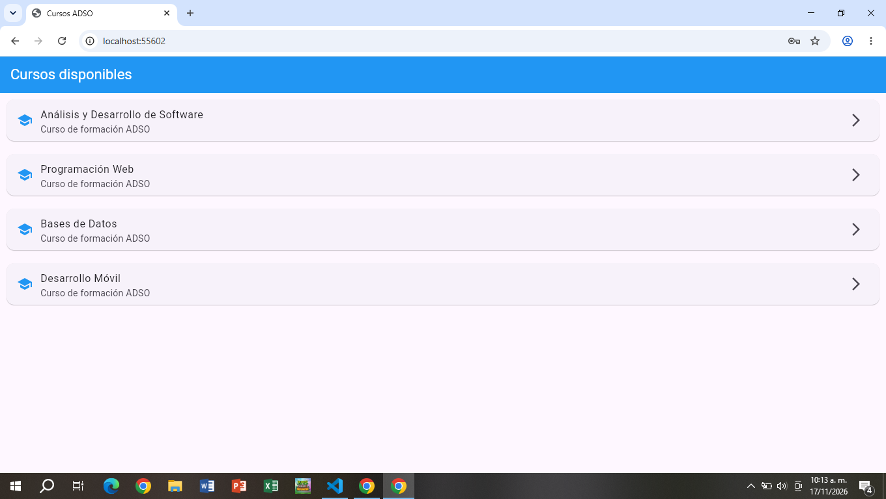
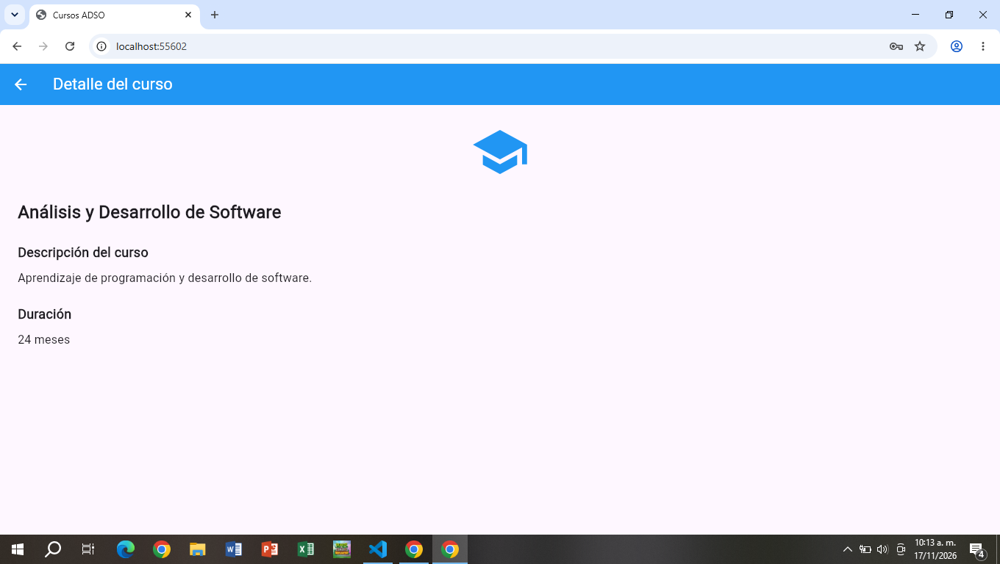

# Cursos ADSO

## Descripción del proyecto

Cursos ADSO es una aplicación desarrollada con Flutter que permite visualizar diferentes cursos de formación y consultar información sobre cada uno de ellos.

El proyecto busca ofrecer una interfaz sencilla y fácil de utilizar para consultar la oferta de cursos.

## Tecnologías utilizadas

- Flutter
- Dart
- Visual Studio Code
- Git y GitHub

## Funcionalidades principales

- Inicio de sesión con validación de campos.
- Validación básica del correo electrónico.
- Opción para mostrar y ocultar la contraseña.
- Visualización de cursos disponibles.
- Consulta de detalles de cada curso.
- Información sobre el nombre, descripción y duración de los cursos.

## Estructura del proyecto

```text
lib/
├── main.dart
├── models/
│   └── curso.dart
└── views/
    ├── login_view.dart
    ├── home_view.dart
    └── detail_view.dart
```

## Evidencias del proyecto

En esta sección se agregarán capturas de pantalla de:

1. Pantalla de inicio de sesión.
2. Pantalla de cursos disponibles.
3. Pantalla de detalles del curso.


## Evidencias del proyecto

### 1. Inicio de sesión



### 2. Cursos disponibles



### 3. Detalle del curso


